# <div align="center">VaultKey — Enterprise License Server & Quantum Credential Vault</div>

<div align="center">



[](https://nodejs.org/)
[](https://nextjs.org/)
[](https://react.dev/)
[](https://www.typescriptlang.org/)
[](https://www.mongodb.com/)
[](https://developer.chrome.com/docs/extensions/mv3/)
[](#cryptographic-engine)
[](#security-architecture)

**An ultra-secure, hardware-enforced software licensing ecosystem, zero-leak credential vault, and Manifest V3 Chrome Extension powered by HS512 authentication and AES-256-GCM AEAD encryption.**

[Features](#-key-features) • [Architecture](#-animated-architecture) • [Quick Start](#-quick-start-guide) • [Chrome Extension](#-chrome-extension-manifest-v3) • [API Documentation](#-rest-api-reference) • [License](#-license)

</div>

---

## ⚡ Key Features

### 🛡️ Hardware-Enforced Software Licensing
- **Cryptographic License Keys**: Generates standardized, formatted license keys (`VKPRO-XXXX-XXXX-XXXX`) signed and verified via SHA-256 tamper-proof hashes.
- **Hardware ID (HWID) Fingerprint Binding**: Restricts client activations to specific machine signatures, MAC hashes, or server serials.
- **Tier-Based Activation Caps**: Configurable activation thresholds per tier (`personal`, `pro`, `enterprise`, `lifetime`).
- **Real-Time Revocation & Expiration**: Instantly blacklist stolen licenses with audit logs, expiration timestamps, and reactivation controls.

### 🔐 Zero-Leak Cryptographic Credential Vault
- **AES-256-GCM Authenticated Encryption (AEAD)**: Passwords, API tokens, certificates, and SSH keys are encrypted with 32-byte master keys using isolated 16-byte initialization vectors (IV) and 16-byte authentication tags.
- **On-Demand Decryption**: Ciphertexts remain encrypted at rest inside MongoDB; plaintext secrets are only decrypted in memory upon authenticated request.
- **Metadata Tagging & Search**: Categorize credentials by type (`api_key`, `password`, `token`, `certificate`, `ssh_key`), domain, or custom tags.

### 🔑 Quantum-Grade HS512 Authentication
- **4096-Bit Cryptographic Secrets**: JWT access tokens are signed using 512-byte cryptographic keys for quantum-resistant signature resilience.
- **Token Rotation & Session Protection**: Silent refresh token rotation with HTTP-only cookies and automatic theft detection (hashes stored and validated in DB).
- **Google OAuth 2.0 Integration**: Built-in Passport strategy for passwordless single sign-on.
- **Anti-Brute Force Protection**: Automatic 15-minute lockouts after 5 consecutive failed login attempts and rate limiting.

### 💎 Apple-Inspired Liquid Glass UI
- **Modern Next.js 16 Web Dashboard**: Built with React 19, Tailwind CSS v4, and Framer Motion.
- **Dynamic Theming**: Seamless dark/light liquid glass theme toggle with CSS variable adaptation.
- **Interactive License Generator**: Real-time playground to generate keys, activate machines, and inspect cryptographic payloads.

### 🧩 Chrome Extension (Manifest V3)
- **Active Tab Domain Detection**: Automatically captures the active tab URL and domain name for effortless credential storage.
- **Smart Form Autofill**: Securely injects credentials into login forms with single-click autofill and clipboard fallback.
- **Integrated Key & Password Generators**: High-entropy crypto password generator and formatted license key builder right in your browser toolbar.
- **Direct Backend Connectivity**: Configurable API endpoints with live server status indicator.

---

## 🏗️ Animated Architecture

<div align="center">



</div>

### Cryptographic Workflow
1. **Client / Extension Authentication**: Clients submit credentials to `/api/auth/login`. The server computes bcrypt password comparisons and issues an **HS512-signed Access Token** alongside a hashed refresh token.
2. **Encrypted Storage Pipeline**:
   $$\text{Ciphertext} = \text{AES-256-GCM}_{\text{key}}(\text{Plaintext}, \text{IV})$$
   MongoDB stores only `{ iv, authTag, ciphertext }`. Raw plaintext never touches persistent disk.
3. **Hardware License Verification**: When an external application calls `/api/licenses/verify`, the server checks:
   - Key SHA-256 integrity hash
   - Status (must be `active`)
   - Expiration date
   - HWID machine match or activation allowance ($N < \text{maxActivations}$)

---

## 🚀 Quick Start Guide

### Prerequisites
- [Node.js](https://nodejs.org/) (v18.0.0 or higher)
- [MongoDB](https://www.mongodb.com/try/download/community) (Local instance on `mongodb://127.0.0.1:27017` or Atlas URI)
- Google Chrome (or Chromium-based browser for the extension)

---

### Step 1: Server Setup

```bash
# Navigate to the backend directory
cd server

# Install dependencies
npm install

# Configure environment variables
# Copy or edit .env (configured for local dev out of the box)
```

#### Server Configuration (`server/.env`):
```env
PORT=5000
NODE_ENV=development
MONGODB_URI=mongodb://127.0.0.1:27017/license_vault

# 512-Byte HS512 JWT Secrets
JWT_ACCESS_SECRET=your_512_byte_hex_string
JWT_REFRESH_SECRET=your_512_byte_hex_string
JWT_ACCESS_EXPIRY=15m
JWT_REFRESH_EXPIRY=7d

# AES-256-GCM 32-byte Master Key
ENCRYPTION_KEY=3a53f87e187d441ae0ddc66855a595b4dcdf0718657c2a86f2e8720406c8b9b0
HMAC_SECRET=d578d7d717c8a17f2eaae61b4cae849e09d99887725f5f28f51e6274517b86c04beb2e01558b7227d1fc2767df8f6706a0043f81f827a5fa1bd31573059c225e

CLIENT_URL=http://localhost:3000
CORS_ORIGINS=http://localhost:3000,http://127.0.0.1:3000
```

#### Seed Default Data & Start:
```bash
# (Optional) Seed default admin account & realistic dummy licenses:
npm run seed

# Start server in development mode (with nodemon):
npm run dev
```

> **Default Admin Credentials:**
> - **Email**: `admin@example.com`
> - **Password**: `admin`

---

### Step 2: Next.js Web Client Setup

```bash
# In a new terminal, navigate to the client folder
cd client

# Install dependencies
npm install

# Start Next.js development server
npm run dev
```

Open [http://localhost:3000](http://localhost:3000) in your browser. Click the **"⚡ Demo"** button on the login screen to sign in with one click.

---

### Step 3: Chrome Extension Setup

1. Open Google Chrome and navigate to `chrome://extensions/`.
2. Enable **Developer mode** toggle in the top-right corner.
3. Click **Load unpacked** in the top-left corner.
4. Select the `extension` folder inside this repository:
   ```
   a:/Coding/License_Server/extension
   ```
5. Pin **VaultKey** to your browser toolbar.
6. Click the extension icon. Click **"⚡ Auto-Fill Demo"** and then **"Sign In with HS512"**.

---

## 🧩 Chrome Extension (Manifest V3)

The VaultKey Chrome Extension connects directly to your backend API to give you instant password saving and autofill capabilities everywhere on the web.

```
extension/
├── manifest.json       # Manifest V3 configuration with granular permissions
├── background.js       # Background service worker & context menu shortcuts
├── content.js          # Reactive autofill injector for web login forms
├── popup.html          # High-tech dark glass extension interface
├── popup.css           # Apple Liquid Glass design tokens & micro-animations
├── popup.js            # Storage management, HS512 auth, and crypto generators
└── icons/              # Multi-resolution extension icons (16, 48, 128px)
```

### Key Capabilities:
- **Save Tab**: Detects active domain name, pre-fills website URL, and encrypts credentials directly into the database with AES-256-GCM.
- **Vault Tab**: Decrypt and copy passwords to clipboard or trigger reactive autofill on any form.
- **Generator Tab**: Cryptographically secure password and `VKPRO-` license key generator with entropy strength meters.
- **Account Tab**: Fast demo login, live session verification, and server connection ping diagnostics.

---

## 📡 REST API Reference

### Base URL: `http://localhost:5000/api`

### 1. Authentication (`/api/auth`)
| Method | Endpoint | Description | Auth Required |
|:---|:---|:---|:---:|
| `POST` | `/api/auth/register` | Register new user account | No |
| `POST` | `/api/auth/login` | Login with email/password; returns HS512 JWT | No |
| `POST` | `/api/auth/refresh` | Refresh access token using cookie | Refresh Cookie |
| `POST` | `/api/auth/logout` | Invalidate refresh token and clear cookies | Bearer JWT |
| `GET` | `/api/auth/me` | Fetch authenticated user profile | Bearer JWT |
| `GET` | `/api/auth/google` | Initiate Google OAuth 2.0 flow | No |

### 2. License Management (`/api/licenses`)
| Method | Endpoint | Description | Auth Required |
|:---|:---|:---|:---:|
| `POST` | `/api/licenses` | Issue new license key (`VKPRO-...`) | Bearer JWT |
| `GET` | `/api/licenses` | List all licenses with pagination & search | Bearer JWT |
| `GET` | `/api/licenses/:id` | Get license metadata and activation list | Bearer JWT |
| `GET` | `/api/licenses/:id/reveal` | Decrypt and reveal the raw license key | Bearer JWT |
| `POST` | `/api/licenses/verify` | Verify key validity and HWID machine lock | None (Public) |
| `POST` | `/api/licenses/:id/activate`| Register a machine HWID to this license | Bearer JWT |
| `POST` | `/api/licenses/:id/revoke` | Revoke license and terminate activations | Bearer JWT |
| `DELETE`| `/api/licenses/:id` | Delete license record permanently | Bearer JWT |

### 3. Credential Vault (`/api/vault`)
| Method | Endpoint | Description | Auth Required |
|:---|:---|:---|:---:|
| `POST` | `/api/vault` | Encrypt & save new credential | Bearer JWT |
| `GET` | `/api/vault` | List encrypted credentials (metadata only) | Bearer JWT |
| `GET` | `/api/vault/:id/decrypt` | Decrypt secret value on-demand | Bearer JWT |
| `PUT` | `/api/vault/:id` | Update credential metadata or secret | Bearer JWT |
| `PATCH`| `/api/vault/:id/archive` | Toggle archive state | Bearer JWT |
| `DELETE`| `/api/vault/:id` | Delete secret from vault | Bearer JWT |

---

### Verification Code Examples

#### cURL (Verify License Key):
```bash
curl -X POST http://localhost:5000/api/licenses/verify \
  -H "Content-Type: application/json" \
  -d '{
    "licenseKey": "VKPRO-7X9B-4KQ2-9M1L",
    "machineId": "SRV-PROD-US-EAST-01"
  }'
```

#### Node.js / TypeScript:
```typescript
import axios from 'axios';

async function checkLicense(key: string, hwid: string) {
  const { data } = await axios.post('http://localhost:5000/api/licenses/verify', {
    licenseKey: key,
    machineId: hwid,
  });

  if (data.valid) {
    console.log(`✅ License verified: ${data.productName} (${data.tier})`);
  } else {
    console.error(`❌ Invalid license: ${data.message}`);
  }
}
```

#### Python:
```python
import requests

response = requests.post(
    "http://localhost:5000/api/licenses/verify",
    json={"licenseKey": "VKPRO-7X9B-4KQ2-9M1L", "machineId": "SRV-01"}
)
result = response.json()
print("Valid:" if result.get("valid") else "Denied:", result.get("message"))
```

---

## 🔒 Security Architecture

| Security Layer | Implementation | Purpose |
|:---|:---|:---|
| **Data Encryption at Rest** | `aes-256-gcm` (AEAD) | Full confidential integrity with 128-bit auth tags |
| **Token Signatures** | `HS512` (HMAC SHA-512) | 512-byte cryptographic session verification |
| **Password Hashing** | `bcryptjs` (Cost factor 12) | Protection against dictionary and rainbow attacks |
| **Tamper-Proof Keys** | `SHA-256` deterministic hash | Fast key lookup without ever storing plaintext keys |
| **Network Security** | `helmet` + Strict CORS | Dynamic origin enforcement for Chrome extensions |
| **Brute Force Protection** | `express-rate-limit` | Tiered limits for auth (100 req/15m) and verify (20 req/m) |

---

## 📂 Project Structure

```
License_Server/
├── assets/
│   ├── hero-banner.svg             # Animated vector banner with scanner & orbits
│   └── architecture-animation.svg  # Animated end-to-end dataflow topology
├── client/                         # Next.js 16 Web Dashboard
│   ├── app/
│   │   ├── dashboard/              # Protected management dashboard
│   │   │   ├── generator/          # Interactive Key Generator & Playground
│   │   │   ├── licenses/           # License ledger & machine activation tracker
│   │   │   ├── vault/              # AES-256-GCM Credential Vault
│   │   │   └── settings/           # System settings & audits
│   │   ├── login/                  # Apple liquid glass login portal
│   │   └── register/               # Free vault creation portal
│   ├── contexts/AuthContext.tsx    # Reactive JWT session provider
│   └── lib/api.ts                  # Axios client with auto-refresh interceptors
├── extension/                      # Chrome Extension (Manifest V3)
│   ├── popup.html                  # Glassmorphic extension popup
│   ├── popup.js                    # Reactive autofill, demo sign-in & vault sync
│   ├── content.js                  # DOM credential injector for web login forms
│   └── manifest.json               # Manifest V3 definition
├── server/                         # Express REST API Server
│   ├── src/
│   │   ├── app.js                  # Express application with extension CORS support
│   │   ├── controllers/            # Auth, License, and Vault route handlers
│   │   ├── models/                 # Mongoose schemas (User, License, Vault)
│   │   ├── utils/crypto.js         # AES-256-GCM AEAD & HS512 crypto library
│   │   └── utils/seed.js           # Automated dummy admin data seeder
│   └── package.json
└── README.md
```

---

## 📄 License

This project is licensed under the **MIT License**. Feel free to use, modify, and distribute for personal and commercial projects.
